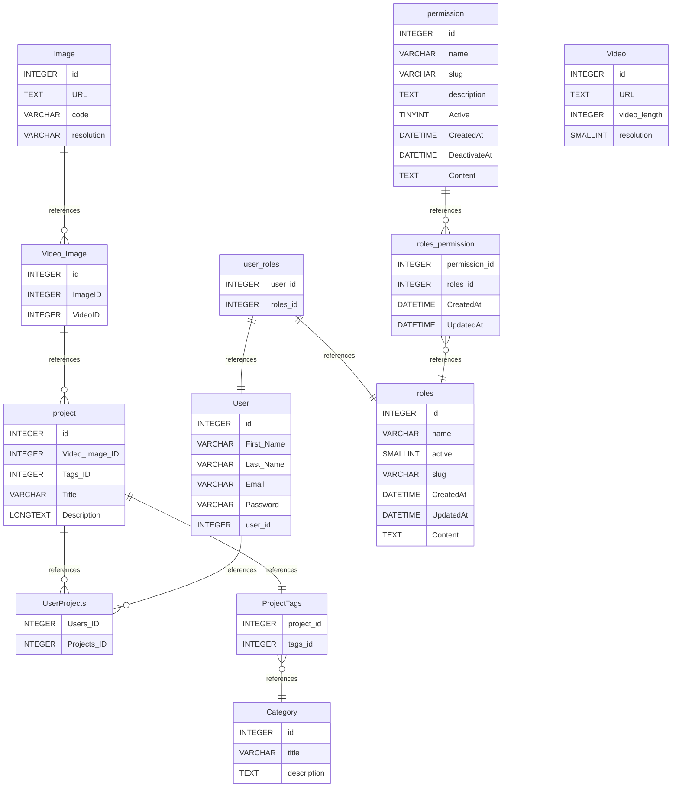

# Untitled Diagram documentation

## Summary

- [Introduction](#introduction)
- [Database Type](#database-type)
- [Table Structure](#table-structure)
  - [project](#project)
  - [User](#user)
  - [UserProjects](#userprojects)
  - [Image](#image)
  - [Video](#video)
  - [Video/Image](#video/image)
  - [ProjectTags](#projecttags)
  - [user_roles](#user_roles)
  - [Category](#category)
  - [roles](#roles)
  - [permission](#permission)
  - [roles_permission](#roles_permission)
- [Relationships](#relationships)
- [Database Diagram](#database-diagram)

## Introduction

## Database type

- **Database system:** MySQL

## Table structure

### project

| Name               | Type            | Settings                       | References                     | Note |
| ------------------ | --------------- | ------------------------------ | ------------------------------ | ---- |
| **id**             | INTEGER         | 🔑 PK, not null, autoincrement | Contain many Projects          |      |
| **Video/Image_ID** | INTEGER         | null                           |                                |      |
| **Tags_ID**        | INTEGER         | null                           | fk_project_Tags_ID_ProjectTags |      |
| **Title**          | VARCHAR(255)    | not null                       |                                |      |
| **Description**    | LONGTEXT(65535) | not null                       |                                |      |

### User

| Name           | Type         | Settings                       | References         | Note |
| -------------- | ------------ | ------------------------------ | ------------------ | ---- |
| **id**         | INTEGER      | 🔑 PK, not null, autoincrement | Contain Many Users |      |
| **First_Name** | VARCHAR(255) | null                           |                    |      |
| **Last_Name**  | VARCHAR(255) | null                           |                    |      |
| **Email**      | VARCHAR(255) | not null, unique               |                    |      |
| **Password**   | VARCHAR(255) | not null, unique               |                    |      |
| **user_id**    | INTEGER      | not null                       |                    |      |

### UserProjects

| Name            | Type    | Settings | References | Note |
| --------------- | ------- | -------- | ---------- | ---- |
| **Users_ID**    | INTEGER | not null |            |      |
| **Projects_ID** | INTEGER | not null |            |      |

### Image

| Name           | Type        | Settings                       | References          | Note |
| -------------- | ----------- | ------------------------------ | ------------------- | ---- |
| **id**         | INTEGER     | 🔑 PK, not null, autoincrement | Contain many Images |      |
| **URL**        | TEXT(65535) | not null                       |                     |      |
| **code**       |             | not null                       |                     |      |
| **resolution** |             | not null                       |                     |      |

### Video

| Name             | Type        | Settings                       | References          | Note |
| ---------------- | ----------- | ------------------------------ | ------------------- | ---- |
| **id**           | INTEGER     | 🔑 PK, not null, autoincrement | Contain many Videos |      |
| **URL**          | TEXT(65535) | null                           |                     |      |
| **video.length** | INTEGER     | null                           |                     |      |
| **resolution**   | SMALLINT    | null                           |                     |      |

### Video/Image

| Name        | Type    | Settings                       | References                | Note |
| ----------- | ------- | ------------------------------ | ------------------------- | ---- |
| **id**      | INTEGER | 🔑 PK, not null, autoincrement | Contain Many Images/Video |      |
| **ImageID** | INTEGER | null                           |                           |      |
| **VideoID** | INTEGER | null                           |                           |      |

### ProjectTags

| Name           | Type    | Settings | References                                         | Note |
| -------------- | ------- | -------- | -------------------------------------------------- | ---- |
| **project_id** | INTEGER | not null |                                                    |      |
| **tags_id**    | INTEGER | not null | fk_ProjectTags_tags_id_table_X5DBtxAKAWpoYSU9JkGK3 |      |

### user_roles

| Name         | Type    | Settings | References                   | Note |
| ------------ | ------- | -------- | ---------------------------- | ---- |
| **user_id**  | INTEGER | not null | fk_user_roles_user_id_User   |      |
| **roles_id** | INTEGER | not null | fk_user_roles_roles_id_roles |      |

### Category

| Name            | Type         | Settings                       | References | Note |
| --------------- | ------------ | ------------------------------ | ---------- | ---- |
| **id**          | INTEGER      | 🔑 PK, not null, autoincrement |            |      |
| **title**       | VARCHAR(255) | not null                       |            |      |
| **description** | TEXT(65535)  | not null                       |            |      |

### roles

| Name          | Type         | Settings                | References | Note |
| ------------- | ------------ | ----------------------- | ---------- | ---- |
| **id**        | INTEGER      | not null, autoincrement |            |      |
| **name**      | VARCHAR(255) | not null                |            |      |
| **active**    | SMALLINT     | not null                |            |      |
| **slug**      | VARCHAR(255) | not null                |            |      |
| **CreatedAt** | DATETIME     | not null                |            |      |
| **UpdatedAt** | DATETIME     | not null                |            |      |
| **Content**   | TEXT(65535)  | null                    |            |      |

### permission

| Name             | Type         | Settings                       | References                        | Note |
| ---------------- | ------------ | ------------------------------ | --------------------------------- | ---- |
| **id**           | INTEGER      | 🔑 PK, not null, autoincrement | fk_permission_id_roles_permission |      |
| **name**         | VARCHAR(255) | not null                       |                                   |      |
| **slug**         | VARCHAR(255) | not null                       |                                   |      |
| **description**  | TEXT(65535)  | not null                       |                                   |      |
| **Active**       | TINYINT      | not null                       |                                   |      |
| **CreatedAt**    | DATETIME     | not null                       |                                   |      |
| **DeactivateAt** | DATETIME     | not null                       |                                   |      |
| **Content**      | TEXT(65535)  | null                           |                                   |      |

### roles_permission

| Name              | Type     | Settings                | References                         | Note |
| ----------------- | -------- | ----------------------- | ---------------------------------- | ---- |
| **permission_id** | INTEGER  | not null                |                                    |      |
| **roles_id**      | INTEGER  | not null, autoincrement | fk_roles_permission_roles_id_roles |      |
| **CreatedAt**     | DATETIME | not null                |                                    |      |
| **UpdatedAt**     | DATETIME | not null                |                                    |      |

## Relationships

- **project to UserProjects**: one_to_many
- **User to UserProjects**: one_to_many
- **Video to Video/Image**: one_to_many
- **Image to Video/Image**: one_to_many
- **Video/Image to project**: one_to_many
- **project to ProjectTags**: one_to_one
- **ProjectTags to Category**: many_to_one
- **user_roles to User**: one_to_one
- **user_roles to roles**: one_to_one
- **permission to roles_permission**: one_to_many
- **roles_permission to roles**: many_to_one

## Database Diagram

